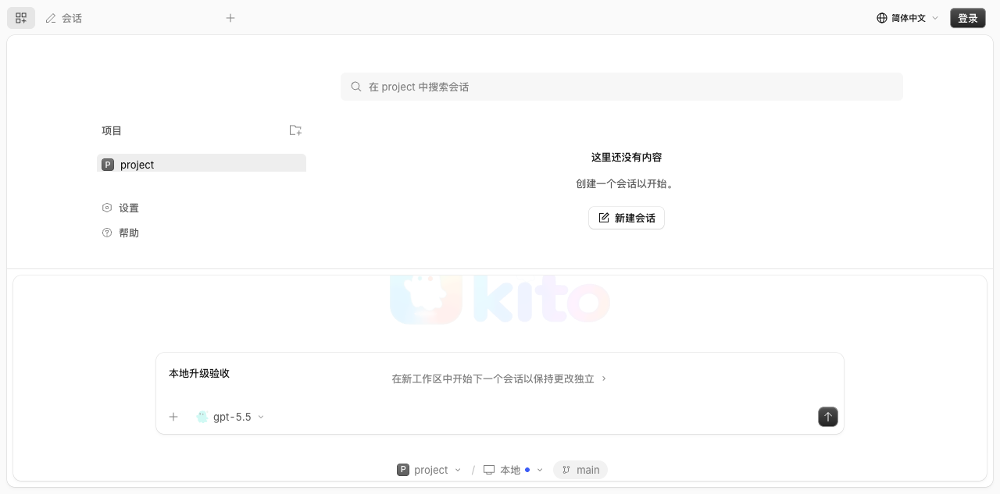
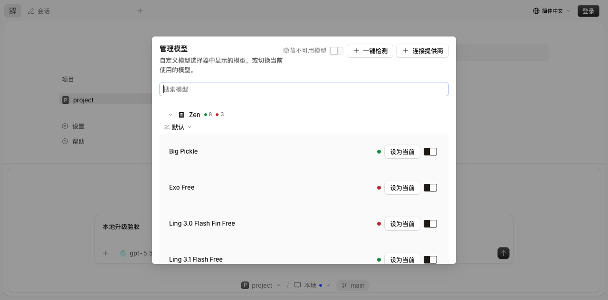

# Kito / OpenCode 2.0.27 升级验收

2026-10-13（Asia/Shanghai）。官方稳定标签 `v2.0.27`，提交 `1f4d07a4a519185955ae8ab2ea3607805509e386`。框架包版本 2.0.27，Bun 1.4.2，Kito 产品版本线仍为 `KTAI_VERSION` 2.1。

## 本机验证

环境：macOS Apple Silicon，Bun 1.4.2，现代 Bash 5.3 与系统 ripgrep。测试通过 core 的隔离脚本运行；使用临时 HOME、XDG 和 KITO 数据目录。

| 检查 | 结果 |
| --- | --- |
| 全仓 `bun turbo typecheck --concurrency=3` | 36/36 包通过 |
| `packages/core`：`bun run test` | 6730 通过，43 跳过，0 失败 |
| `packages/app`：`bun run test:unit` | 792 通过，0 失败 |
| `packages/app`：`bun run test:browser` | 175 通过，0 失败 |
| `packages/desktop`：`bun test` | 174 通过，1 跳过，0 失败 |
| `packages/ai`：`bun run test` | 1793 通过，28 跳过，0 失败 |
| `packages/server`：`bun run test` | 84 通过，1 跳过，0 失败；使用隔离 HOME / XDG / KITO 环境 |
| `packages/ui`：`bun test` | 155 通过，0 失败 |
| `packages/util`：`bun run test` | 99 通过，0 失败 |
| Core Shell 权限与执行定向复测 | 90 通过，19 跳过，0 失败；573 个断言。本机无 PowerShell，相关场景由 CI 检查 |
| Server 文件 / MCP 进程复用定向复测 | 3 通过，207 个断言，0 失败 |
| Core 快照 / MCP / npm Git / 遥测集成定向复测 | 112 通过，0 失败；默认 30 秒测试预算 |
| Git / Snapshot 回归复测 | 28 通过，108 个断言，0 失败；包括持续损坏索引仍返回错误 |
| Linux Chromium 原生分页压力复测 | 6 / 6 通过；Playwright 1.59.1 官方 noble ARM64 镜像，4 CPU / 8 GiB、2 个浏览器并发；保留原场景与断言 |
| TUI 全量复测 | 1463 通过，2 跳过，0 失败；108247 个断言、2 个快照 |
| TUI 回填展开 / 精确滚动恢复重复验证 | 25 通过，0 失败；首屏正文等待原生异步解析，输入前等待绘制稳定，保留原断言 |
| 全仓 `bun turbo test --concurrency=3` | 27 / 27 任务通过，核心 6730、CLI 336、Server 84、AI 1793、TUI 1463 均零失败 |
| `packages/cli`：`bun test test/web-ui.test.ts` | 3 通过，90 个断言，0 失败 |
| Protocol / Kito 契约 / 网站 OpenAPI 生成检查 | 通过 |
| CLI `build --single --skip-install`（prod / 2.0.27） | arm64 原生二进制构建通过，`--version` 返回 `opencode v2.0.27` |
| Desktop `build`（prod / 2.0.27 / 本地 CLI_DIST） | main、preload、renderer 构建通过 |
| Node CLI `build-node.ts --single --skip-install` 与 `service-smoke.ts --node` | Apple Silicon 构建与完整服务生命周期通过 |
| HTTP API codegen `bun test` | 99 通过，0 失败；覆盖具名类型和真实 binary wildcard 请求 |
| CLI `script/service-smoke.ts` | 通过：两个服务竞争唯一注册、查询鉴权、插件热加载、内嵌网页和退出清理 |

跳过项由现有测试的平台/工具条件决定。这里只验证 Apple Silicon 本机产物；PR 的 CLI、macOS arm64 / x64 PKG、Windows 安装包构建已全部通过（提交 2f0c28bf6e）。同一提交的 Windows 全仓测试 27 / 27 任务通过（Core 5647、TUI 1453、CLI 335；平台条件跳过项保留），Bun / Node 编译服务生命周期和 428 个浏览器场景全部通过。最终提交的完整 CI 以 PR 检查为准。

## 真实 HTTP 与页面

从构建出的 CLI 在隔离临时目录启动真实服务，通过独立浏览器会话访问内嵌网页：

- 网页标题为 Kito；`/api/info` 返回版本 2.0.27。未鉴权返回 401。
- `/ktai/credential` 未鉴权返回 401；鉴权后返回 JSON `{identity:false,keyPresent:false}`，不会被网页回退路由拦截。
- 未登录访问 `/ktai/account` 返回 401 与明确的 Identity 错误。
- 浏览器新增回归确认：首页草稿保存后刷新保持，提交前没有可见空标签页，提交后打开新会话并只投递一次提示词。
- 打开项目后首页可输入提示词；模型从 Exo Free 切换为 gpt-5.5 后持久显示。
- 管理模型显示 Zen / Kito 分组、默认/显示偏好、探测进度与不可用过滤。
- 顶栏登录生成 Telegram 登录挑战与二维码；关闭弹窗会取消挑战。未完成 Telegram 授权。
- 未登录发送 Kito 模型提示词会先打开登录弹窗；关闭后输入内容保留，没有创建推理请求。
- 浏览器未捕获异常列表为空。

## 升级回归修复

- 首页输入框使用自己的持久化草稿，隔离页面切换与输入焦点；隐藏未提交的首页草稿标签，提交后使用原生会话晋升流程。
- 快捷键目录按框架版本记录有效命令；Settings 刷新后仍能显示有效的会话命令，旧框架的失效命令隐藏。
- 保留上游多语言的复数类别；更新旧测试的工具完成事件为不可变结果的重复投递。
- CLI 配置、数据库、服务注册路径统一为 KITO 选择器与 kito 目录；显式端口冲突报错，默认端口被外部程序占用时选择空闲端口。
- Windows 并发快照的 20 轮压力验证复现 2 轮失败：Git 写入相同树对象时临时返回 `Permission denied`（[CI 日志](https://github.com/KTAIorg/kt-opencode/actions/runs/38347810956/job/115133162616)）。幂等的 `write-tree` 在 Windows 上最多重试 3 次，每次间隔 50 毫秒；持续错误仍返回原错误。CI 保留 20 轮并发回归，所有快照必须成功；2100 个文件 / 16 批压包的完整性场景在 Windows 使用 120 秒预算。
- CI 显式安装 ripgrep；Linux / Windows 包测试串行执行，步骤总预算 30 分钟；浏览器并发 2，给 V2 diff / syntax Worker 保留资源。核心集成测试使用 30 秒预算，MCP / Shell 子进程启动等待使用独立的 15 秒预算。TUI App fixture 的 HTTP / 原生 Markdown 解析异步等待使用 80 帧预算，显式场景预算优先；直接使用 renderer 的两个首屏 Markdown 场景同样等待 80 帧；展开与滚动断言保持原值。场景在绘制稳定后发送下一次快捷键，避免布局尚未提交时读写滚动锚点。Bun 与 Node 编译服务生命周期保持独立验证。

## 交付边界

框架升级保留官方标签作为 merge commit 的第二父提交，防止下一次升级失去上游共同祖先。PR 不应 squash 合并。

合入 main 会触发原有安装包正式发布流水线；正式发布需要用户授权。钱包充值、实际付费推理、生产数据迁移和已安装客户端升级不属于本次本机验收。
